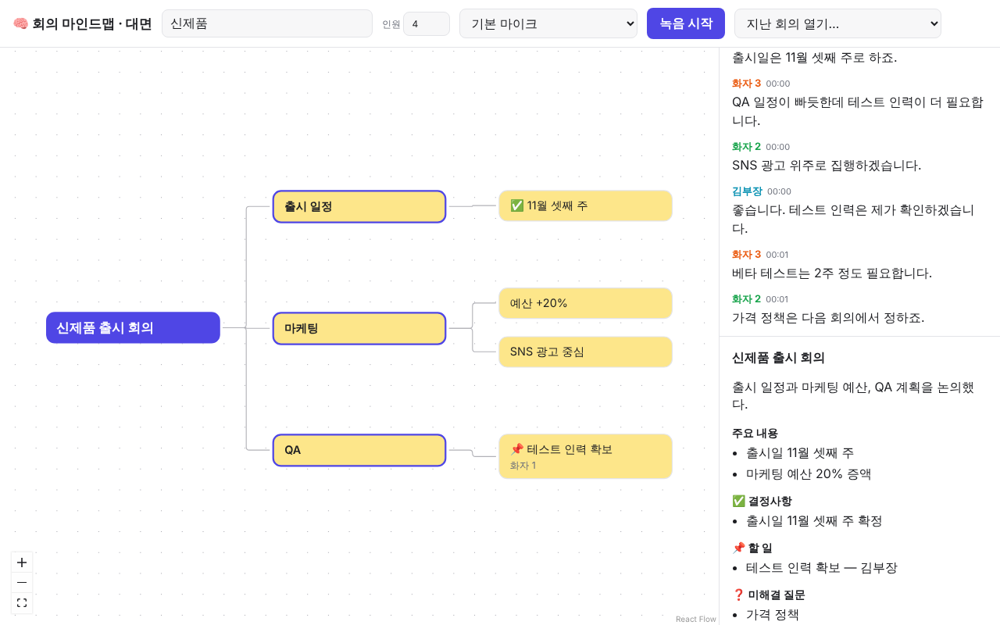

# 🧠 회의 마인드맵

회의를 녹음하면서 **화자별 실시간 자막 → 자동 요약 → 실시간으로 자라는 마인드맵 → 종료 시 회의록**을 만들어 주는 앱입니다.
사용 환경에 따라 두 가지 버전이 있습니다.

| | A. 온라인 회의 (Teams / Zoom) | B. 오프라인 회의 (대면) |
|---|---|---|
| 위치 | `apps/desktop` (Electron) | `apps/web` (Next.js 웹앱 / PWA) |
| 녹음 | 시스템 오디오(상대방) + 내 마이크, 2채널 따로 | 테이블 위 기기 마이크 1개 |
| 화자 | 마이크 = "나", 시스템 오디오는 화자분리 → "참가자 1, 2…" | 화자분리 → "화자 1, 2…" → 이름 지정 |
| 특징 | 회의 봇 없음, "회의 옆에 띄우기" 작은 창 모드, 에코 중복 제거 | 폰에서도 동작, 화면 꺼짐 방지, 인원 수 힌트 |



## 구조

```
packages/core   두 앱 공통 로직 (프레임워크 무관, 단위 테스트 포함)
  mindmap/      마인드맵 타입, 패치 적용(applyPatch), 배치 스케줄러
  transcript/   STT 토큰 → 화자별 발언, 화자 이름, 에코 중복 판별
  stt/          STT 공급자 인터페이스 + Soniox 실시간 클라이언트
  audio/        MediaStream → 16kHz PCM (AudioWorklet)
  prompts/      Claude 프롬프트와 출력 스키마 (서버 전용)
packages/ui     공통 React 화면: 마인드맵(React Flow), 자막, 요약, 화자 이름, 회의 컨트롤러, 로컬 저장(IndexedDB)
apps/web        B. 오프라인 버전 + 두 버전이 함께 쓰는 API 서버
  /api/stt-token  Soniox 단기 키 발급 (진짜 키는 서버에만)
  /api/mindmap    새 발언 → Claude Haiku 5.5 → 마인드맵 변경 명령 + 요약
  /api/summary    종료 시 전체 기록 → Claude Sonnet 5.5 → 회의록
apps/desktop    A. 온라인 버전 (Electron 메인 + Vite/React 렌더러)
```

흐름: `오디오 → PCM → Soniox(한국어+화자분리) → 확정 발언 → 20초 또는 8문장마다 /api/mindmap → 패치 적용 → 화면` · 종료 시 `/api/summary`.
마인드맵은 매번 새로 만들지 않고 **변경 명령(add/update/move/merge)만** 받아서 노드가 흔들리지 않게 자랍니다.

## 실행

준비물: Node 22+, pnpm 10, [Anthropic API 키](https://console.anthropic.com), [Soniox API 키](https://soniox.com)

```bash
cd meeting-mindmap
pnpm install
cp apps/web/.env.example apps/web/.env.local   # ANTHROPIC_API_KEY, SONIOX_API_KEY 입력
```

**B. 오프라인 버전**
```bash
pnpm dev:web            # http://localhost:3000
```
폰에서 쓰려면 HTTPS로 배포(예: Vercel)해야 마이크 권한이 열립니다. 배포 후 "홈 화면에 추가"하면 앱처럼 쓸 수 있습니다.

**A. 온라인 버전** (API 서버로 `apps/web`이 같이 떠 있어야 함)
```bash
pnpm dev:web                                   # 터미널 1
pnpm --filter @mm/desktop dev                  # 터미널 2: 렌더러 (Vite)
pnpm --filter @mm/desktop dev:electron         # 터미널 3: Electron 창
pnpm --filter @mm/desktop dist                 # 설치 파일 만들기 (Windows/macOS)
```
- Windows: 별도 설정 없이 시스템 오디오가 잡힙니다.
- macOS 13+: 처음 실행 시 "화면 및 시스템 오디오 기록" 권한을 허용해야 합니다. Electron/macOS 버전에 따라 동작이 달라 **실기기 확인이 필요**합니다.
- 헤드셋을 쓰면 내 마이크에 상대방 소리가 섞이지 않아 정확도가 올라갑니다.

## 테스트

```bash
pnpm test        # core 단위 테스트 (패치 적용, 스케줄러, 발언 조립, 화자/에코)
pnpm typecheck
pnpm build
```

## 알아둘 점

- Soniox 실시간 모델 이름은 `packages/core/src/stt/soniox.ts`의 `SONIOX_DEFAULT_MODEL`(현재 `stt-rt-v3`)입니다. Soniox 문서에서 최신 모델명을 확인해 바꿔주세요. STT 공급자를 바꾸려면 `SttSession` 인터페이스만 구현하면 됩니다.
- 오디오는 저장하지 않고, 자막·마인드맵·회의록만 브라우저(IndexedDB)에 저장합니다. 녹음 전 참석자 동의를 받아주세요.
- 전체 계획과 기술 조사: [docs/PLAN.md](docs/PLAN.md)
